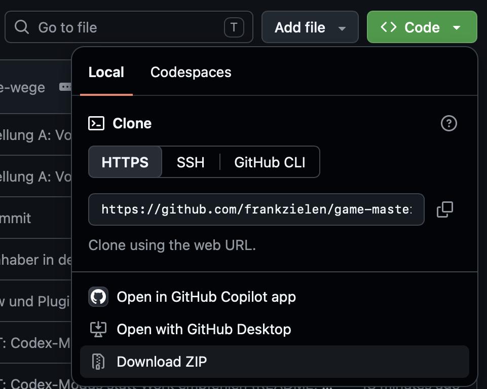
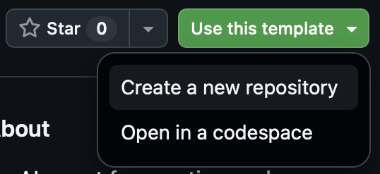
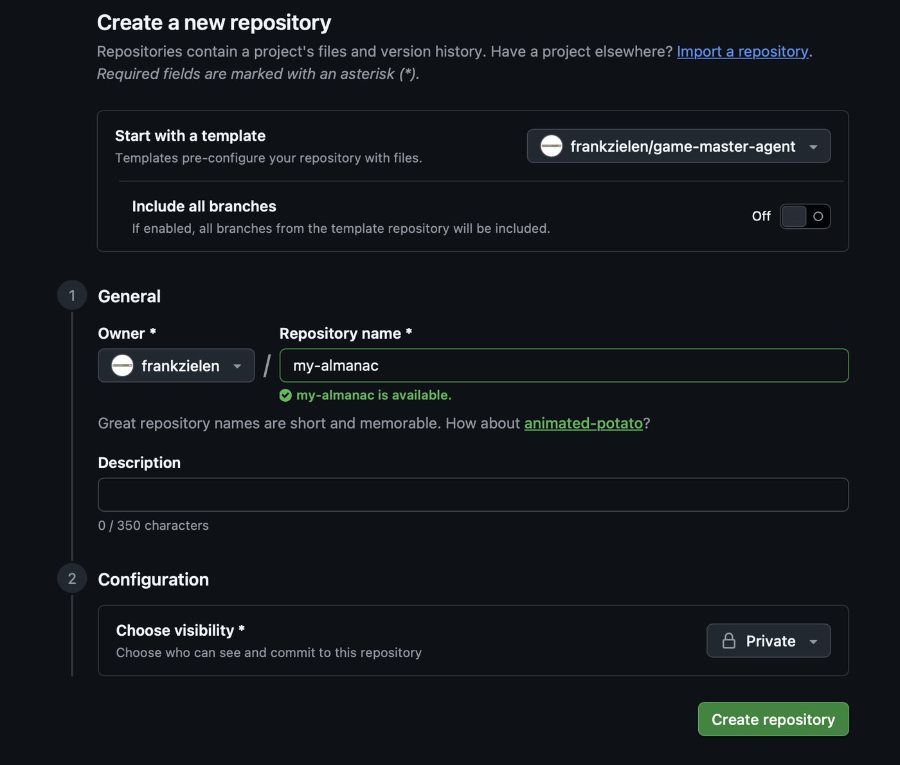
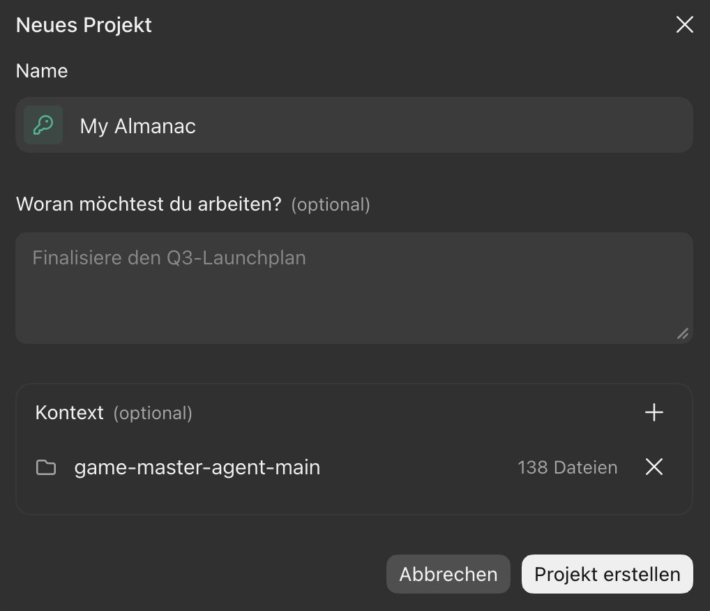
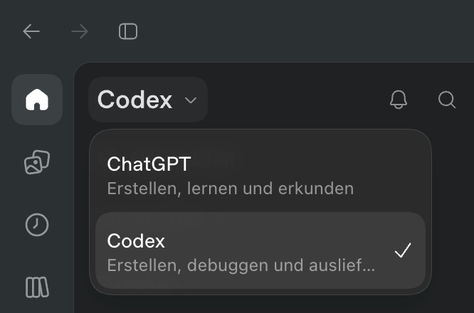
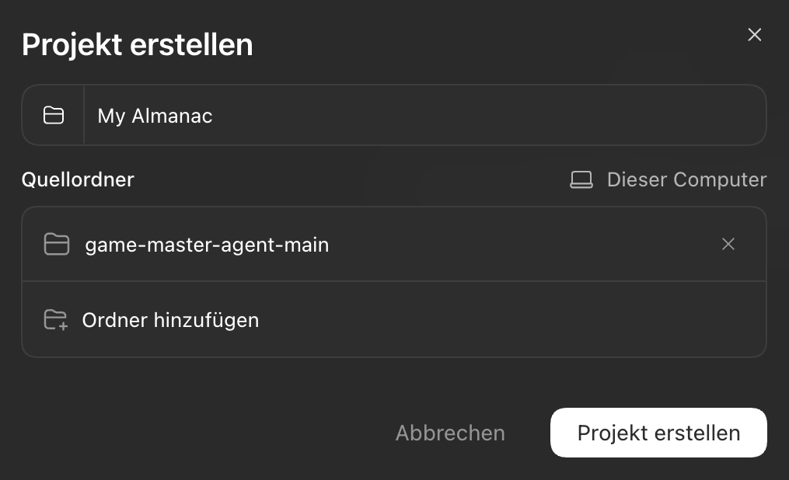
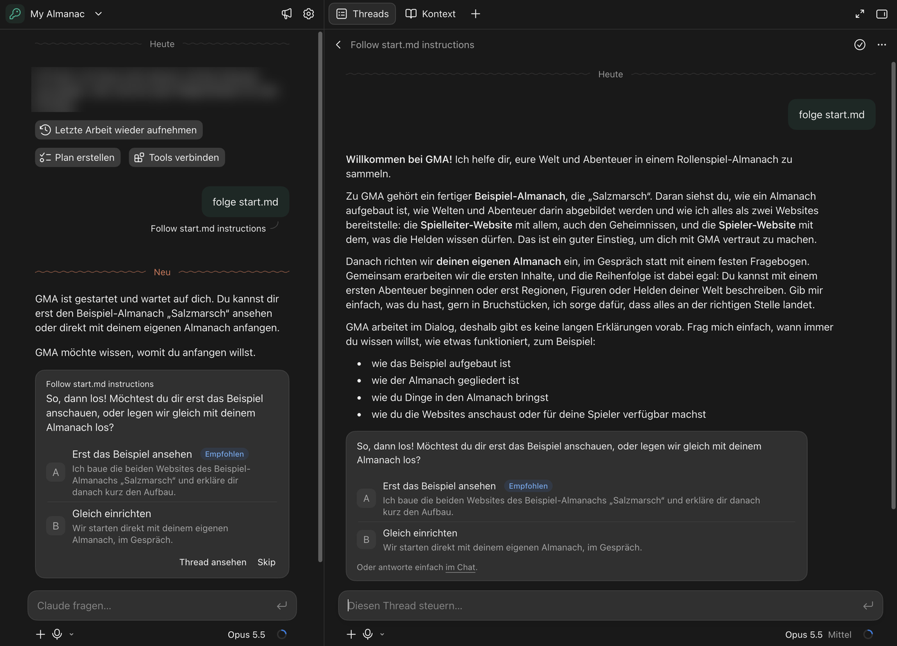

# GMA – Game Master Agent

**An AI agent for creating and managing pen & paper RPG worlds and adventures.**

[English](#english) · [Deutsch](#deutsch)

---

## English

GMA turns an AI coding agent (Claude, ChatGPT and similar) into a game master's assistant. You talk to it like a colleague: dictate ideas, session reports or notes, hand it maps and stat blocks. The agent files everything into your **role-playing almanac**, a fixed folder structure for your world and all its adventures, checks it for contradictions, keeps cross-references up to date and can publish it as a website.

GMA is not a program with its own AI. It is a set of rules, templates and small tools that an existing agent reads and follows.

### What you can use it for

- **Create and prepare adventures:** design your own adventures, or bring existing and purchased ones into a structured form for your group.
- **Build worlds:** places, characters, factions, items and history, independent of any single adventure.
- **Document played adventures:** record what the group experienced and how the world changed.

Not only for game masters: players can document sessions too, taking turns or together, and help build the world.

### How it works

1. **Input:** notes, dictated ideas and session reports, handouts, images, stat blocks, sound and music, in any form.
2. **Storage:** linked Markdown files in a fixed structure. The world exists once, each adventure only holds its own plot and sessions, and the game master may change from adventure to adventure. Every world entry shows what is timeless, its current state and what happened in each adventure. Secrets are marked in the data.
3. **Output:** a website to browse, in two versions: the complete **game master website** and a cleaned **player website** that only shows what the characters know. It runs offline, and the agent can publish it for your players via Claude or ChatGPT, on your own web space (e.g. GitHub Pages) or as a ZIP. Public or private is your choice.

GMA works with any rules system. Everything rule-specific lives in a system profile (`almanach/systeme/`). Included: **No rules system** (free-form values, default) and **D&D 5e** (field names based on the SRD 5.2). The agent helps you create profiles for other systems.

### Requirements

- A project in the Claude app or in Codex in the ChatGPT app, connected either to a folder on your computer or to a GitHub repository. Plain chats without folder access are not suitable. This usually requires a paid plan; check the current plans of Anthropic and OpenAI.
- Python 3 for the website tools (no extra packages). The agent helps you install it if needed.

### Getting started

**1. Get GMA.** Choose one of two ways:

- **Local folder (recommended):** on GitHub, click **Code → Download ZIP** and unpack the ZIP.

  

- **or GitHub repository:** requires a GitHub account. Click **Use this template → Create a new repository**, give your copy a name and keep it private.

  

  

**2. Create a project and connect the folder or your copy.**

- **Claude app:** create a new project and under "Context" click **+ → Add folder** (or "Add repository" for your GitHub copy). If Claude asks whether it may work in your folder, choose "Always allow".

  

- **ChatGPT app:** first switch to **Codex** at the top. In "Work" mode the agent cannot reach the internet and therefore cannot publish the websites, and "Chat" does not support local folders. Then create a project and add the unpacked folder as source folder. For a GitHub copy, write in the chat instead: "Connect to repository NAME".

  

  

**3. Start.** Start a new chat in the project and write: "Follow START.md."

The agent does the rest: it first offers to show you the example almanac, then sets up your almanac with you in conversation, in any order. Claude projects run the setup in a separate thread and show only a short summary in the main chat. Click **View thread**: the welcome message and the choice are there, and the setup continues there.

If you work with Claude Code, simply open the folder there. The screenshots show the Mac apps with a German interface.

### Working with the agent

- **Ideas:** just tell or dictate them, fragments are fine. If something contradicts, the agent asks and suggests solutions.
- **After a session:** tell it what happened. The agent writes the session log and updates characters and world.
- **Material:** send images, maps, handouts, stat blocks or music and say what they belong to.
- **Websites:** after changes the agent offers to rebuild the websites, just for you or online as well, and opens them in your browser.
- **Questions:** ask the agent any time how something works. If you want something to work differently, tell it, and it adjusts the rules.

The rules for the agent are in [almanach/AGENTS.md](almanach/AGENTS.md). They are in German, but the agent talks to you in your language and writes your almanac in it. The website interface, the folder structure and the example almanac are in German for now.

### What's in the repository

| Folder | Content |
|---|---|
| `almanach/` | the empty almanac: rules for the agent (`AGENTS.md`), templates, system profiles, tools |
| `beispiel/` | a small fictional example almanac. Ask the agent "Show me the example" and you get both websites to compare |

### Licence

- GMA (rules, templates, system profiles, tools and the example almanac): [MIT](LICENSE). You may use, change, share and sell GMA freely, including commercially, as long as the copyright notice and license text stay included.
- Your own almanac is yours: whatever content you create with GMA (adventures, worlds, texts, images) you may publish and sell.
- D&D profile: includes material from the SRD 5.2 by Wizards of the Coast LLC, licensed under CC BY 4.0; this material stays under CC BY 4.0 (see the profile). "Dungeons & Dragons" and "D&D" are trademarks of Wizards of the Coast; GMA is not affiliated with or endorsed by Wizards of the Coast.
- Purchased adventures may be prepared for your own group, but do not publish their text.

---

## Deutsch

GMA macht aus einem KI-Agenten (Claude, ChatGPT und ähnliche) einen Assistenten für die Spielleitung. Man spricht mit ihm wie mit einem Kollegen: Ideen, Spielberichte oder Notizen einsprechen, Karten und Statblöcke übergeben. Der Agent legt alles in deinem **Rollenspiel-Almanach** ab, einer festen Ordnerstruktur für deine Welt und all ihre Abenteuer, prüft auf Widersprüche, hält Querverweise aktuell und macht den Bestand als Website verfügbar.

GMA ist kein eigenes Programm mit eigener KI. Es besteht aus Regeln, Vorlagen und kleinen Werkzeugen, die ein vorhandener Agent liest und befolgt.

### Wozu man GMA nutzen kann

- **Abenteuer erstellen und aufbereiten:** eigene Abenteuer entwerfen, oder vorhandene und gekaufte Abenteuer strukturiert für die eigene Gruppe aufbereiten.
- **Welten erstellen:** Orte, Figuren, Fraktionen, Gegenstände und Geschichte, unabhängig von einzelnen Abenteuern.
- **Gespielte Abenteuer dokumentieren:** festhalten, was die Gruppe erlebt hat und wie sich die Welt verändert.

Nicht nur für Spielleitungen: Auch Spielerinnen und Spieler können dokumentieren, abwechselnd oder gemeinsam, und beim Weltenbau mitwirken.

### Wie GMA arbeitet

1. **Eingabe:** Notizen, eingesprochene Ideen und Spielberichte, Handouts, Bilder, Statblöcke, Musik und Geräusche, in beliebiger Form.
2. **Ablage:** verlinkte Markdown-Dateien in fester Struktur. Die Welt gibt es nur einmal, jedes Abenteuer hat nur seinen Plot und seine Sitzungen, und die Spielleitung darf von Abenteuer zu Abenteuer wechseln. Jeder Welt-Eintrag zeigt das Zeitlose, den aktuellen Stand und was im jeweiligen Abenteuer geschah. Geheimnisse sind in den Daten gekennzeichnet.
3. **Ausgabe:** eine Website zum Durchklicken in zwei Fassungen: die vollständige **Spielleiter-Website** und eine bereinigte **Spieler-Website**, die nur zeigt, was die Helden wissen. Sie läuft offline, und der Agent stellt sie deinen Spielern auf Wunsch bereit: über Claude oder ChatGPT, auf eigenem Webspace (z. B. GitHub Pages) oder als ZIP. Öffentlich oder privat entscheidest du.

GMA ist an kein Regelsystem gebunden. Alles Regelspezifische steht in einem Systemprofil (`almanach/systeme/`). Mitgeliefert: **Ohne Regelsystem** (freie Werte, Standard) und **D&D 5e** (Feldnamen nach dem SRD 5.2). Für andere Systeme legt der Agent mit dir ein Profil an.

### Voraussetzungen

- Ein Projekt in der Claude-App oder in Codex in der ChatGPT-App, verbunden mit einem Ordner auf deinem Rechner oder mit einem GitHub-Repository. Normale Chats ohne Ordnerzugriff sind nicht geeignet. Dafür ist in der Regel ein Bezahltarif nötig; die aktuellen Tarife von Anthropic und OpenAI bitte selbst prüfen.
- Python 3 für die Website-Werkzeuge (ohne Zusatzpakete). Der Agent hilft bei Bedarf bei der Installation.

### Loslegen

**1. GMA holen.** Wähle einen von zwei Wegen:

- **Lokaler Ordner (empfohlen):** auf GitHub **Code → Download ZIP** klicken und das ZIP entpacken.

  

- **oder GitHub-Repository:** Dafür brauchst du ein GitHub-Konto. **Use this template → Create a new repository** klicken, der Kopie einen Namen geben und sie privat lassen.

  

  

**2. Projekt anlegen und Ordner oder Kopie verbinden.**

- **Claude-App:** ein neues Projekt anlegen und unter „Kontext“ **+ → Ordner hinzufügen** wählen (für die GitHub-Kopie „Repository hinzufügen“). Fragt Claude, ob es in deinem Ordner arbeiten darf, „Immer erlauben“ wählen.

  

- **ChatGPT-App:** zuerst oben auf **Codex** umschalten. Im Modus „Work“ erreicht der Agent das Internet nicht und kann die Websites deshalb nicht veröffentlichen, „Chat“ unterstützt keine lokalen Ordner. Dann ein Projekt erstellen und den entpackten Ordner als Quellordner hinzufügen. Für die GitHub-Kopie stattdessen im Chat schreiben: „Verbinde mit Repository NAME“.

  

  

**3. Starten.** Im Projekt einen neuen Chat beginnen und schreiben: „Folge START.md.“

Den Rest erledigt der Agent: Er bietet dir zuerst das Beispiel an und richtet dann im Gespräch mit dir deinen Almanach ein, in beliebiger Reihenfolge. Claude-Projekte führen die Einrichtung in einem eigenen Thread aus und zeigen im Hauptchat nur eine Kurzfassung. Klicke auf **Thread ansehen**: Dort stehen die Begrüßung und die Auswahl, und dort geht die Einrichtung weiter.

Wer mit Claude Code arbeitet, öffnet den Ordner einfach dort. Die Bilder zeigen die Mac-Apps mit deutscher Oberfläche.

### So arbeitest du mit dem Agenten

- **Ideen:** einfach erzählen oder einsprechen, gern in Bruchstücken. Bei Widersprüchen fragt der Agent nach und schlägt Lösungen vor.
- **Nach einem Spielabend:** erzählen, was passiert ist. Der Agent schreibt das Protokoll und bringt Helden und Welt auf den neuesten Stand.
- **Material:** Bilder, Karten, Handouts, Statblöcke oder Musik schicken und sagen, wozu sie gehören.
- **Websites:** Nach Änderungen bietet der Agent an, die Websites neu zu bauen, nur für dich oder auch online, und öffnet sie in deinem Browser.
- **Fragen:** Frag den Agenten jederzeit, wie etwas funktioniert. Soll etwas anders laufen, sag es ihm, er passt die Regeln an.

Die Regeln für den Agenten stehen in [almanach/AGENTS.md](almanach/AGENTS.md).

### Was im Repository liegt

| Ordner | Inhalt |
|---|---|
| `almanach/` | der leere Almanach: Regeln für den Agenten (`AGENTS.md`), Vorlagen, Systemprofile, Werkzeuge |
| `beispiel/` | ein kleiner erfundener Beispiel-Almanach. Sag dem Agenten „Zeig mir das Beispiel“, dann bekommst du beide Websites zum Vergleichen |

### Lizenz

- GMA (Regelwerk, Vorlagen, Systemprofile, Werkzeuge und Beispiel-Almanach): [MIT](LICENSE). GMA darf frei genutzt, verändert, weitergegeben und auch verkauft werden, auch kommerziell, solange Copyright-Hinweis und Lizenztext erhalten bleiben.
- Dein eigener Almanach gehört dir: Die Inhalte, die du mit GMA erstellst (Abenteuer, Welten, Texte, Bilder), darfst du veröffentlichen und verkaufen.
- D&D-Profil: enthält Material aus dem SRD 5.2 von Wizards of the Coast LLC unter CC BY 4.0; dieses Material bleibt unter CC BY 4.0 (siehe Profil). „Dungeons & Dragons“ und „D&D“ sind Marken von Wizards of the Coast; GMA steht in keiner Verbindung zu Wizards of the Coast.
- Gekaufte Abenteuer dürfen für die eigene Gruppe aufbereitet, ihr Text aber nicht veröffentlicht werden.
