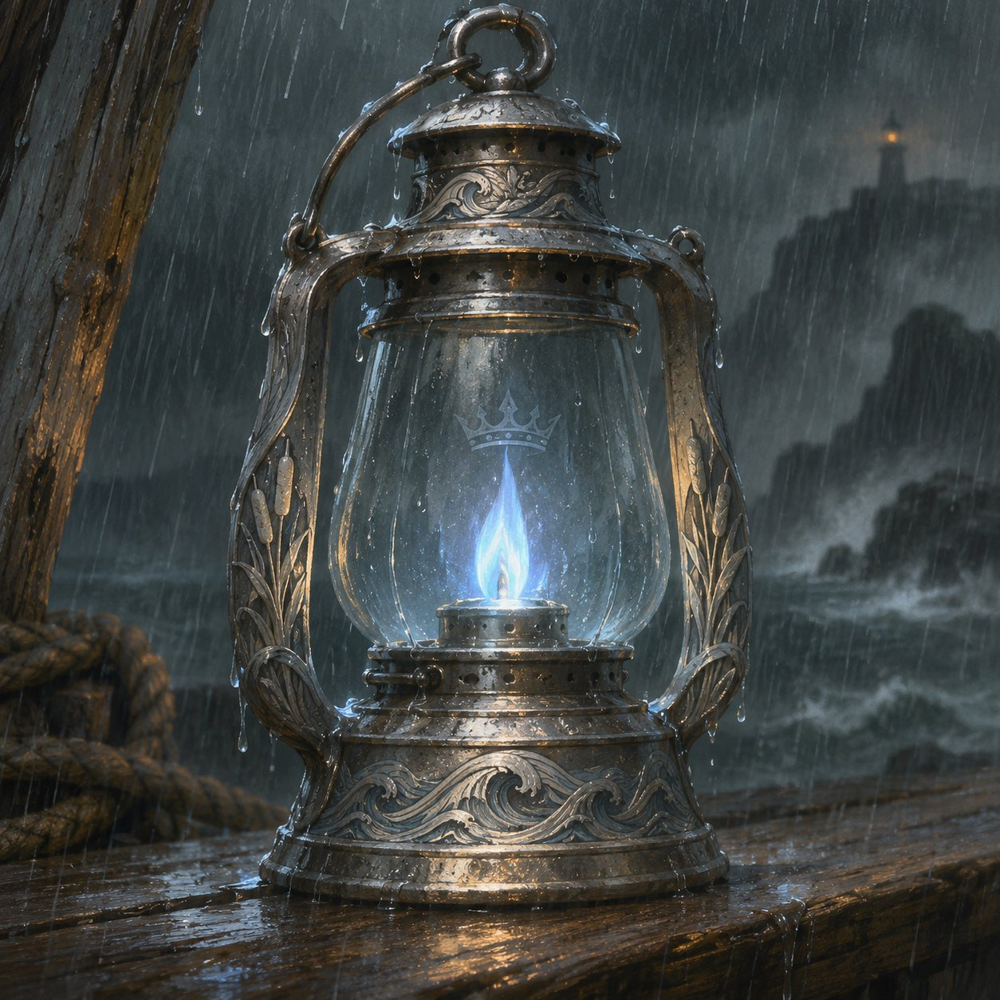

# Silberne Laterne

_Quelle: KI-generiert mit ChatGPT_

_Art: wundersamer Gegenstand; Seltenheit: selten; Einstimmung: nicht erforderlich; Wirkung: erlischt nie, verrät ihrer Besitzerin den Weg zum Träger_

## Beschreibung
Eine fein gearbeitete Laterne, die auch im Sturm nicht erlischt. Das Silber ist mit Wellen und Schilfhalmen verziert, auf dem Glas ist eine winzige Krone eingeätzt, die man nur im Gegenlicht sieht. Die Flamme brennt bläulich weiß und ohne Öl.

## Eigenschaften
- Spendet helles Licht im Radius von 9 m und dämmriges Licht für weitere 9 m.
- Erlischt weder im Wind noch im Regen.
- Wird heller, wenn Boote des Bundes der Salzkrone in der Nähe sind.

## Herkunft und Geschichte
Die Laterne gehörte [Vela Brandt](../../nscs/vela-brandt/vela-brandt.md). Wer sie trägt, den findet Vela, wo immer er ist. So hat sie die Gruppe im alten Salzwerk erwartet.

## Entwicklung über die Abenteuer
**Aktueller Stand (nach 02 · Die Salzkrone):** im Besitz von [Bren](../../spielercharaktere/bren/bren.md).

### 01 · Das stille Feuer
- Fundort: [Szene 02](../../../abenteuer/01-das-stille-feuer/plot/kapitel-01-ankunft-in-graufurt/szene-02-die-schmugglerhoehle.md)

### 02 · Die Salzkrone
- Was geschah: [Kap. 1](../../../abenteuer/02-die-salzkrone/plot/kapitel-01-ins-herz-der-marsch/kapitel-01-ins-herz-der-marsch.md) · [Kap. 2](../../../abenteuer/02-die-salzkrone/plot/kapitel-02-das-alte-salzwerk/kapitel-02-das-alte-salzwerk.md)

## Geheim (nur SL)
Die Verbindung zu Vela besteht weiter. Solange Bren die Laterne trägt, weiß sie, wo er ist.

## Wo zu finden
bei [Bren](../../spielercharaktere/bren/bren.md)
