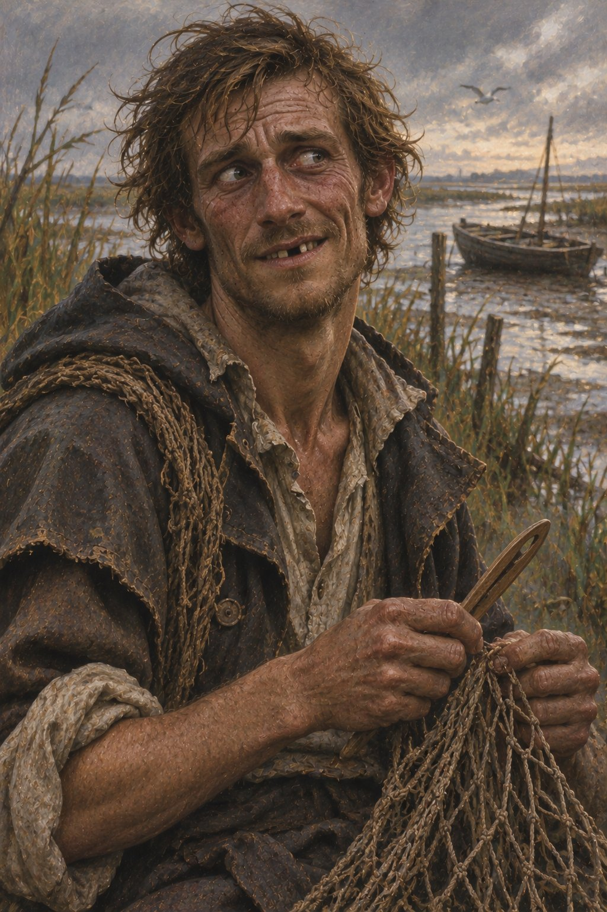

# Jorin Quell

_Quelle: KI-generiert mit ChatGPT_

**Kurz:** Fischer aus Graufurt, Maras jüngerer Bruder, gutmütig und etwas leichtsinnig.
**Charakterfelder:** Volk: Mensch · Gesinnung: chaotisch gut · Rolle: Fischer · Haltung: freundlich
**Aufenthaltsort:** [Graufurt](../../orte/salzmarsch/graufurt/graufurt.md)
**Spielwerte:** [statblock.md](statblock.md)

## Auftreten
Hager, sonnenverbrannt, mit einer Zahnlücke, die er beim Lachen gern zeigt. Redet viel und schnell, vor allem, wenn er nervös ist. „Ich hab doch nur Kisten gefahren, ehrlich!“

## Hintergrund
Jorin kennt die Priele der Marsch fast so gut wie seine Schwester das Meer. Um seine Schulden beim Bootsbauer zu bezahlen, hat er für fremde Leute Kisten durch die Marsch gefahren und nicht gefragt, was darin war.

## Ziele und Motivation
- **Will:** seine Schulden loswerden und Mara nie wieder Kummer machen
- **Fürchtet:** dass die Schmuggler ihn noch einmal holen
- **Verbirgt:** siehe Geheim

## Beziehungen
| NSC / SC | Beziehung |
|---|---|
| [Mara Quell](../mara-quell/mara-quell.md) | ältere Schwester, die ihn großgezogen hat |
| [Ilka](../../spielercharaktere/ilka/ilka.md) | hat ihn aus der Schmugglerhöhle befreit |
| [Bren](../../spielercharaktere/bren/bren.md) | Jugendfreund aus Graufurt |

## Entwicklung über die Abenteuer
**Aktueller Stand (nach 02 · Die Salzkrone):** fischt wieder, hält sich von der Marsch fern.

### 01 · Das stille Feuer
- Was geschah: [Kap. 1](../../../abenteuer/01-das-stille-feuer/plot/kapitel-01-ankunft-in-graufurt/kapitel-01-ankunft-in-graufurt.md) · [Kap. 2](../../../abenteuer/01-das-stille-feuer/plot/kapitel-02-die-spur-ins-schilf/kapitel-02-die-spur-ins-schilf.md)

### 02 · Die Salzkrone
- Was geschah: [Kap. 1](../../../abenteuer/02-die-salzkrone/plot/kapitel-01-ins-herz-der-marsch/kapitel-01-ins-herz-der-marsch.md)

## Geheim (nur SL)
Jorin hat einen Schlüssel zum Bootssteg des Salzwerks behalten und niemandem davon erzählt.

## Verknüpfungen
- **Orte:** [Graufurt](../../orte/salzmarsch/graufurt/graufurt.md), [Altes Salzwerk](../../orte/salzmarsch/altes-salzwerk/altes-salzwerk.md)
- **Quests:** [Quest 01 – Der verschwundene Bruder](../../../abenteuer/01-das-stille-feuer/plot/quests/quest-01-der-verschwundene-bruder.md)
