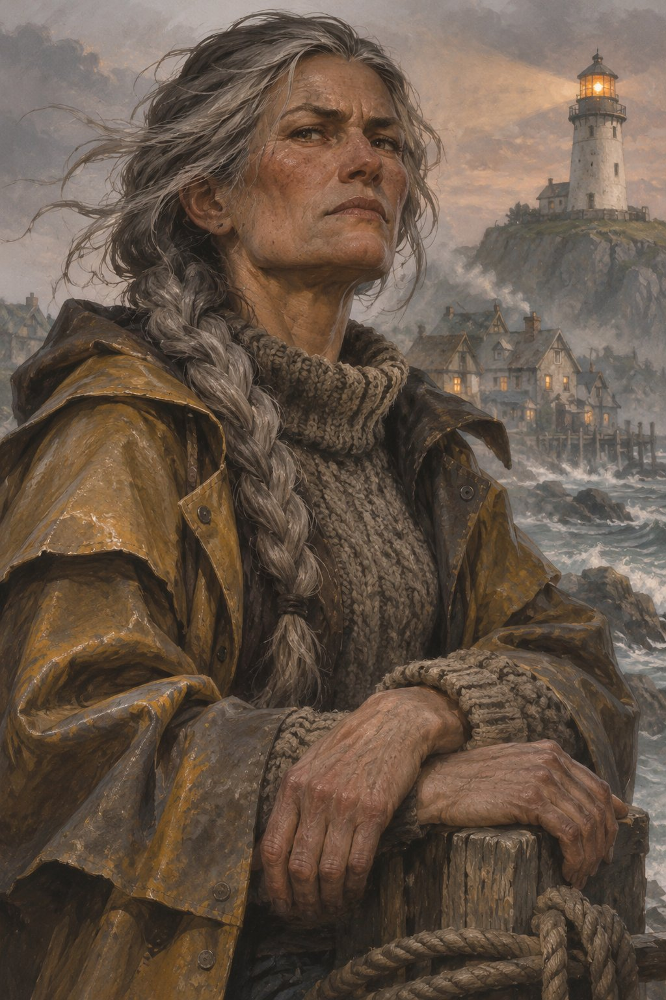

# Mara Quell

_Quelle: KI-generiert mit ChatGPT_

**Kurz:** Leuchtturmwärterin von Graufurt, verschlossen und zäh.
**Charakterfelder:** Rolle: Wärterin · Haltung: freundlich
**Aufenthaltsort:** [Graufurt](../../orte/salzmarsch/graufurt/graufurt.md)
**Spielwerte:** [statblock.md](statblock.md)

## Auftreten
Grauer Zopf, rissige Hände, spricht wenig. „Das Meer nimmt, was es will.“
Trägt bei jedem Wetter denselben ausgeleierten Wollpullover und riecht nach Lampenöl und Teer. Wenn sie nachdenkt, dreht sie einen alten Messingschlüssel zwischen den Fingern.

## Hintergrund
Hütet den Leuchtturm seit zwanzig Jahren. Sie hat ihren jüngeren Bruder [Jorin](../jorin-quell/jorin-quell.md) nach dem frühen Tod der Eltern allein großgezogen und gilt im Dorf als jemand, auf den man sich verlassen kann, auch wenn sie selten lächelt.

## Ziele und Motivation
- **Will:** ihren Bruder in Sicherheit wissen
- **Fürchtet:** die Schmuggler
- **Verbirgt:** siehe Geheim

## Beziehungen
| NSC / SC | Beziehung |
|---|---|
| [Jorin Quell](../jorin-quell/jorin-quell.md) | jüngerer Bruder, für den sie alles tun würde |
| [Ilka](../../spielercharaktere/ilka/ilka.md) | hat ihr den Bruder zurückgebracht, sie schuldet ihr einen Gefallen |
| [Vela Brandt](../vela-brandt/vela-brandt.md) | kennt sie aus Jugendtagen, fürchtet sie |

## Entwicklung über die Abenteuer
**Aktueller Stand (nach 02 · Die Salzkrone):** wieder Herrin ihres Leuchtturms, erleichtert, aber in Sorge, weil Vela entkommen ist.

### 01 · Das stille Feuer
- Was geschah: [Kap. 1](../../../abenteuer/01-das-stille-feuer/plot/kapitel-01-ankunft-in-graufurt/kapitel-01-ankunft-in-graufurt.md) · [Kap. 2](../../../abenteuer/01-das-stille-feuer/plot/kapitel-02-die-spur-ins-schilf/kapitel-02-die-spur-ins-schilf.md)

### 02 · Die Salzkrone
- Was geschah: [Kap. 1](../../../abenteuer/02-die-salzkrone/plot/kapitel-01-ins-herz-der-marsch/kapitel-01-ins-herz-der-marsch.md)

### 03 · Ebbe und Flut (Planung, nur SL)
- Vela schickt ihr eine Botschaft und fordert eine alte Schuld ein.

## Musik und Geräusche
_Nur für die SL, erscheint nicht in der Spieler-Website._

| Wann | Art | Quelle |
|---|---|---|
| Beim Auftritt | Atmosphäre | _knisterndes Lampenfeuer, Wind am Turm_ |

## Geheim (nur SL)
Mara und Vela haben als junge Frauen zusammen im Salzwerk gearbeitet. Mara hat damals Vela beim Zoll gedeckt und dafür Geld genommen. Davon weiß niemand im Dorf, auch Jorin nicht.

## Verknüpfungen
- **Orte:** [Graufurt](../../orte/salzmarsch/graufurt/graufurt.md)
- **NSCs:** [Jorin Quell](../jorin-quell/jorin-quell.md), [Vela Brandt](../vela-brandt/vela-brandt.md)
- **Quests:** [Quest 01 – Der verschwundene Bruder](../../../abenteuer/01-das-stille-feuer/plot/quests/quest-01-der-verschwundene-bruder.md)
