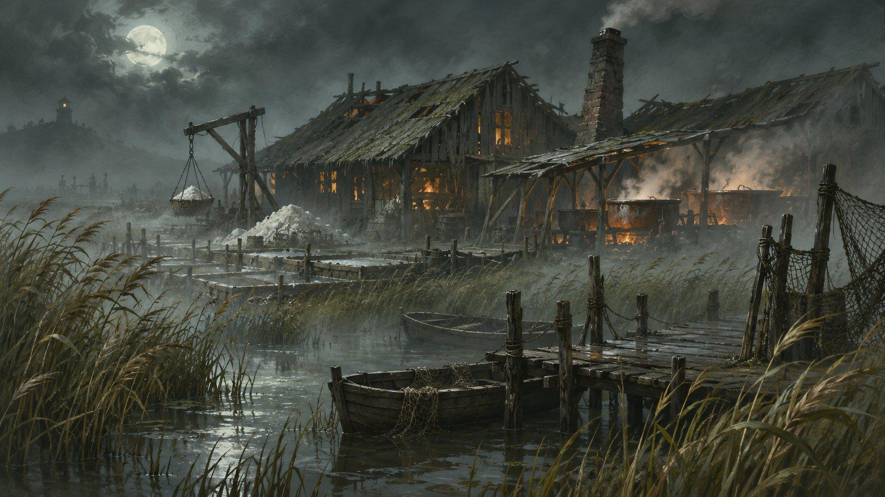

# Altes Salzwerk

Liegt in: [Salzmarsch](../salzmarsch.md)

_Quelle: KI-generiert mit ChatGPT_

**Kurz:** Verfallenes Salzwerk tief in der Marsch, bis vor Kurzem Sitz des Bundes der Salzkrone.

## Erster Eindruck
> Vorlesetext: Aus dem Nebel schälen sich lange Holzschuppen mit eingesunkenen Dächern. Ein schiefer Schornstein ragt in den Himmel, und durch die Ritzen der Wände fällt rötlicher Feuerschein. Es riecht nach Rauch und heißem Salz.

## Beschreibung
Früher wurde hier Sole aus der Marsch in großen Pfannen gesiedet. Die Besitzer gaben das Werk vor zwanzig Jahren auf. Es gibt eine Siedehalle mit sechs Pfannen, ein Kontor mit Schreibstube, Schlafschuppen und einen versteckten Bootssteg an einem tiefen Priel, der auch bei Ebbe Wasser führt.

## Bewohner und wichtige NSCs
- [Vela Brandt](../../../nscs/vela-brandt/vela-brandt.md) – Herrin des Werks (geflohen)

## Aufhänger und Gerüchte
- Unter der Siedehalle soll es einen Keller voller Salzbarren geben, den niemand gefunden hat.

## Entwicklung über die Abenteuer
**Aktueller Stand (nach 02 · Die Salzkrone):** ausgebrannt und verlassen.

### 01 · Das stille Feuer
- Was geschah: [Kap. 2, Szene 03](../../../../abenteuer/01-das-stille-feuer/plot/kapitel-02-die-spur-ins-schilf/szene-03-das-verlassene-bootshaus.md)

### 02 · Die Salzkrone
- Was geschah: [Kap. 2](../../../../abenteuer/02-die-salzkrone/plot/kapitel-02-das-alte-salzwerk/kapitel-02-das-alte-salzwerk.md)

## Musik und Geräusche
_Nur für die SL, erscheint nicht in der Spieler-Website._

| Wann | Art | Quelle |
|---|---|---|
| In der Siedehalle | Atmosphäre | _Blubbern der Pfannen, Knistern des Feuers_ |
| Im Kampf | Musik | _treibende Trommeln_ |

## Geheim (nur SL)
Den Keller gibt es. Vela hat dort Salzbarren im Wert eines kleinen Vermögens versteckt und will sie in Abenteuer 03 holen.

## Verknüpfungen
- **Fraktionen:** [Bund der Salzkrone](../../../fraktionen/bund-der-salzkrone.md)
