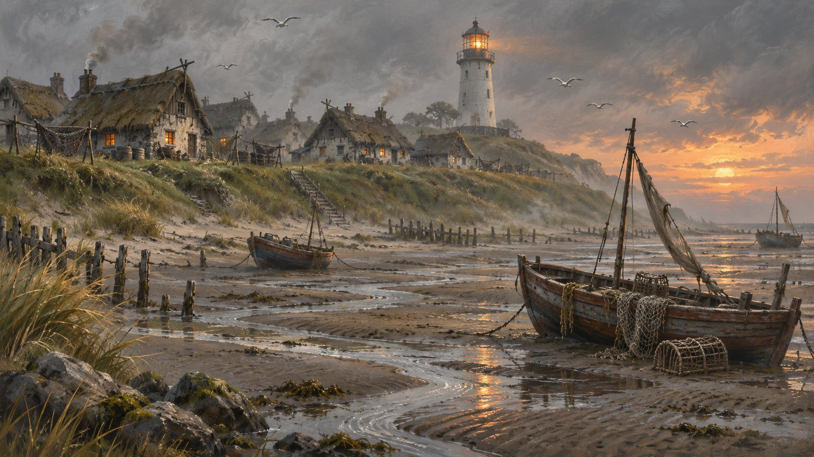

# Graufurt

Liegt in: [Salzmarsch](../salzmarsch.md)

_Quelle: KI-generiert mit ChatGPT_

**Kurz:** Fischerdorf mit Leuchtturm am Rand der Sandbänke.

## Erster Eindruck
> Vorlesetext: Graue Häuser ducken sich hinter einen Deich, darüber ragt der weiße Leuchtturm.

## Beschreibung
Gut sechzig Leute leben hier, fast alle vom Fischfang. Die Häuser haben Reetdächer, die bis fast zum Boden reichen, und an jeder Tür hängen Netze zum Trocknen. Am Deich steht die Schmiede, dahinter der Hafen, der bei Ebbe trockenfällt. Der Leuchtturm warnt die Boote vor den Sandbänken und ist der Stolz des Dorfes.

## Bewohner und wichtige NSCs
- [Mara Quell](../../../nscs/mara-quell/mara-quell.md) – Leuchtturmwärterin
- [Jorin Quell](../../../nscs/jorin-quell/jorin-quell.md) – Fischer
- [Bren](../../../spielercharaktere/bren/bren.md) – Schmied
- Wirtin Tjarde vom „Trockenen Anker“, die alles hört und das meiste weitererzählt

## Aufhänger und Gerüchte
- Im „Trockenen Anker“ wird gewettet, ob die Salzkrone zurückkommt.

## Entwicklung über die Abenteuer
**Aktueller Stand (nach 02 · Die Salzkrone):** Das Leuchtfeuer brennt jede Nacht, das Dorf feiert die Rückkehr der Helden.

### 01 · Das stille Feuer
- Was geschah: [Szene 01](../../../../abenteuer/01-das-stille-feuer/plot/kapitel-01-ankunft-in-graufurt/szene-01-der-erloschene-leuchtturm.md) · [Kap. 2, Szene 01](../../../../abenteuer/01-das-stille-feuer/plot/kapitel-02-die-spur-ins-schilf/szene-01-jorins-bericht.md)

### 02 · Die Salzkrone
- Was geschah: [Kap. 1, Szene 01](../../../../abenteuer/02-die-salzkrone/plot/kapitel-01-ins-herz-der-marsch/szene-01-abschied-in-graufurt.md)

## Musik und Geräusche
_Nur für die SL, erscheint nicht in der Spieler-Website._

| Wann | Art | Quelle |
|---|---|---|
| Beim Betreten | Atmosphäre | _Brandung, eigene Datei in audio/_ |
