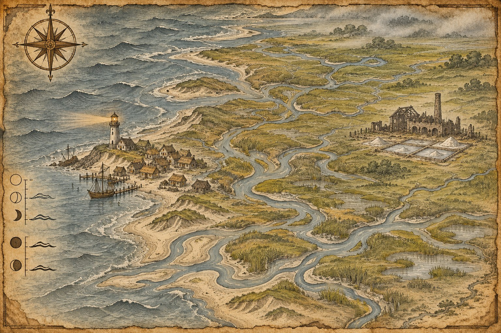

# Salzmarsch

_Quelle: KI-generiert mit ChatGPT_

**Kurz:** Flaches Küstenland aus Prielen, Schilf und Sandbänken.

## Erster Eindruck
> Vorlesetext: So weit das Auge reicht, nur Schilf, Wasser und Himmel. Der Wind trägt den Geruch von Salz und Tang heran, und irgendwo ruft ein Brachvogel.

## Beschreibung
Wer die Marsch nicht kennt, verirrt sich bei Flut. Die Menschen leben von Salz und Fischfang. Zweimal am Tag verändert die Flut das Land: Wege verschwinden, Priele werden zu Flüssen, und Sandbänke tauchen auf, wo eben noch Wasser war. Einheimische fahren mit flachen Kähnen und lesen die Gezeiten wie andere Leute Straßenschilder.

## Orte innerhalb
- [Graufurt](graufurt/graufurt.md)
- [Altes Salzwerk](altes-salzwerk/altes-salzwerk.md)

## Aufhänger und Gerüchte
- Bei Nebel sieht man manchmal Lichter über dem Schilf, die nicht von Booten stammen.
- Seit das Salzwerk verloren ist, ist das Salz in den Küstenstädten doppelt so teuer.

## Entwicklung über die Abenteuer
**Aktueller Stand (nach 02 · Die Salzkrone):** Der Bund der Salzkrone ist zerschlagen, die Priele sind wieder frei.

### 01 · Das stille Feuer
- Was geschah: [Kap. 1](../../../abenteuer/01-das-stille-feuer/plot/kapitel-01-ankunft-in-graufurt/kapitel-01-ankunft-in-graufurt.md) · [Kap. 2](../../../abenteuer/01-das-stille-feuer/plot/kapitel-02-die-spur-ins-schilf/kapitel-02-die-spur-ins-schilf.md)

### 02 · Die Salzkrone
- Was geschah: [Kap. 1](../../../abenteuer/02-die-salzkrone/plot/kapitel-01-ins-herz-der-marsch/kapitel-01-ins-herz-der-marsch.md) · [Kap. 2](../../../abenteuer/02-die-salzkrone/plot/kapitel-02-das-alte-salzwerk/kapitel-02-das-alte-salzwerk.md)

### 03 · Ebbe und Flut (Planung, nur SL)
- Eine Sturmflut droht, die halbe Marsch zu überschwemmen.

## Musik und Geräusche
_Nur für die SL, erscheint nicht in der Spieler-Website._

| Wann | Art | Quelle |
|---|---|---|
| Unterwegs in der Marsch | Atmosphäre | _Wind im Schilf, Vogelrufe, leises Plätschern_ |

## Verknüpfungen
- **Fraktionen:** [Bund der Salzkrone](../../fraktionen/bund-der-salzkrone/bund-der-salzkrone.md)
