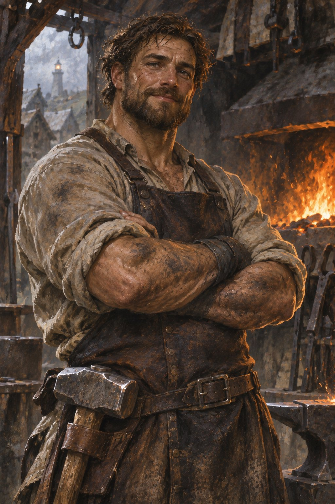

# Bren

_Quelle: KI-generiert mit ChatGPT_

**Spieler:** Robin · **Charakterfelder:** Volk: Mensch · Klasse: Kämpfer · Stufe: 3 · Hintergrund: Handwerker · Herkunft: Graufurt
**Spielwerte:** [statblock.md](statblock.md)

## Hintergrund (Kurzfassung)
Dorfschmied von Graufurt, ruhig, gründlich und schwer aus der Fassung zu bringen. Hat die Schmiede vom Vater übernommen und repariert alles, was Fischer brauchen, vom Anker bis zum Kesselhaken. Mit [Jorin Quell](../../nscs/jorin-quell/jorin-quell.md) ist er seit Kindertagen befreundet.

## Entwicklung über die Abenteuer
**Aktueller Stand (nach 02 · Die Salzkrone):** trägt die [silberne Laterne](../../gegenstaende/silberne-laterne/silberne-laterne.md) und gilt in Graufurt als der Mann, der die Salzkrone vertrieben hat.

### 01 · Das stille Feuer
- Was geschah: [Sitzung 02](../../../abenteuer/01-das-stille-feuer/sitzungen/sitzung-02-2026-01-24.md)

### 02 · Die Salzkrone
- Was geschah: [Sitzung 01](../../../abenteuer/02-die-salzkrone/sitzungen/sitzung-01-2026-02-14.md) · [Sitzung 02](../../../abenteuer/02-die-salzkrone/sitzungen/sitzung-02-2026-02-28.md)

## Offene Fäden
- Vela will ihre Laterne zurück und weiß, wo Bren ist.

## Persönliche Aufhänger für kommende Abenteuer
- Ein Auftrag für eine Kette, die einen ganzen Priel absperren soll.
