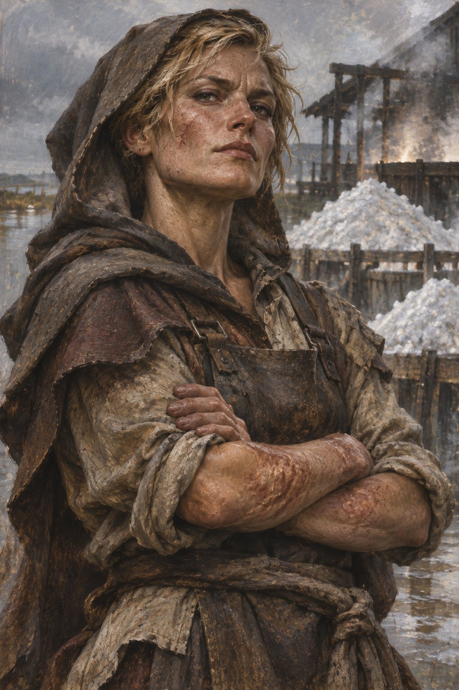

# Hedda Lorn

_Quelle: KI-generiert mit ChatGPT_

**Spieler:** Alex · **Charakterfelder:** Herkunft: Salzmarsch · Rolle: Siederin · Fortschritt: Anfängerin

## Hintergrund (Kurzfassung)
Hat als Mädchen im alten Salzwerk gearbeitet, bis ihr eine überkochende Pfanne die Hände verbrühte. Seitdem hasst sie das Werk und alle, die daran verdienen. Ihre Familie steht noch heute im Schuldbuch des Salzwerks.

## Entwicklung über die Abenteuer
**Aktueller Stand (nach 02 · Die Salzkrone):** hat das [Schuldbuch des Salzwerks](../../gegenstaende/schuldbuch-des-salzwerks.md) an sich genommen und will die Schulden der Arbeiterfamilien tilgen.

### 02 · Die Salzkrone
- Was geschah: [Sitzung 01](../../../abenteuer/02-die-salzkrone/sitzungen/sitzung-01-2026-02-14.md) · [Sitzung 02](../../../abenteuer/02-die-salzkrone/sitzungen/sitzung-02-2026-02-28.md) · [Quest 01](../../../abenteuer/02-die-salzkrone/plot/quests/quest-01-heddas-schuldbuch.md)

## Offene Fäden
- Wer im Schuldbuch steht, hat noch Verwandte in der ganzen Marsch.
