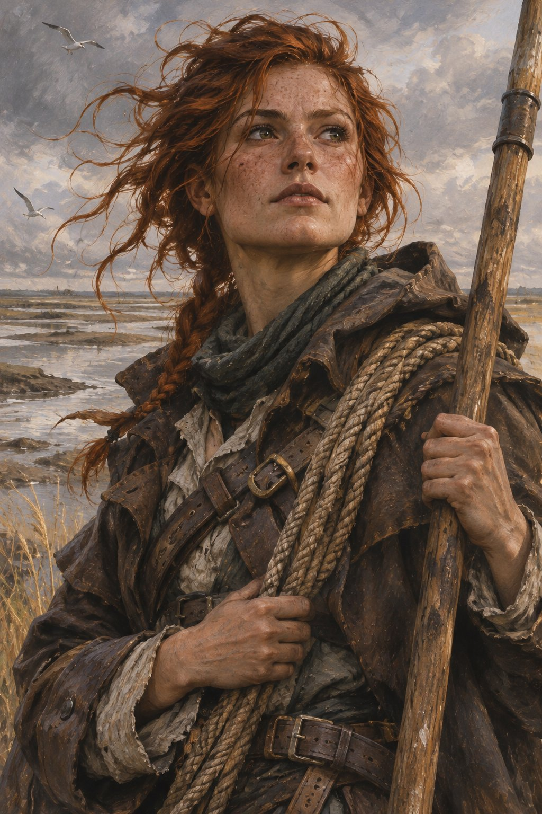

# Ilka

_Quelle: KI-generiert mit ChatGPT_

**Spieler:** Sam · **Charakterfelder:** Volk: Mensch · Klasse: Waldläuferin · Stufe: 2 · Hintergrund: Seefahrerin · Herkunft: Hafenstadt
**Spielwerte:** [statblock.md](statblock.md)

## Hintergrund (Kurzfassung)
Ehemalige Lotsin, kennt Wasser und Wetter. Hat ihre Stelle im Hafen verloren, als ein Schiff trotz ihrer Warnung auf Grund lief, und ist seitdem auf der Suche nach einer neuen Aufgabe.

## Entwicklung über die Abenteuer
**Aktueller Stand (nach 02 · Die Salzkrone):** bleibt in Graufurt und hilft Mara am Leuchtturm. Die [silberne Laterne](../../gegenstaende/silberne-laterne.md) hat sie [Bren](../bren/bren.md) gegeben.

### 01 · Das stille Feuer
- Was geschah: [Sitzung 01](../../../abenteuer/01-das-stille-feuer/sitzungen/sitzung-01-2026-01-10.md) · [Sitzung 02](../../../abenteuer/01-das-stille-feuer/sitzungen/sitzung-02-2026-01-24.md)

### 02 · Die Salzkrone
- Nicht dabei, Sam leitet das Abenteuer. Was geschah: [Kap. 1, Szene 01](../../../abenteuer/02-die-salzkrone/plot/kapitel-01-ins-herz-der-marsch/szene-01-abschied-in-graufurt.md)

## Offene Fäden
- Warum ist das Schiff damals trotz ihrer Warnung auf Grund gelaufen?

## Musik und Geräusche
_Nur für die SL, erscheint nicht in der Spieler-Website._

| Wann | Art | Quelle |
|---|---|---|
| Beim Auftritt | Musik | _leichte Flötenmelodie_ |
